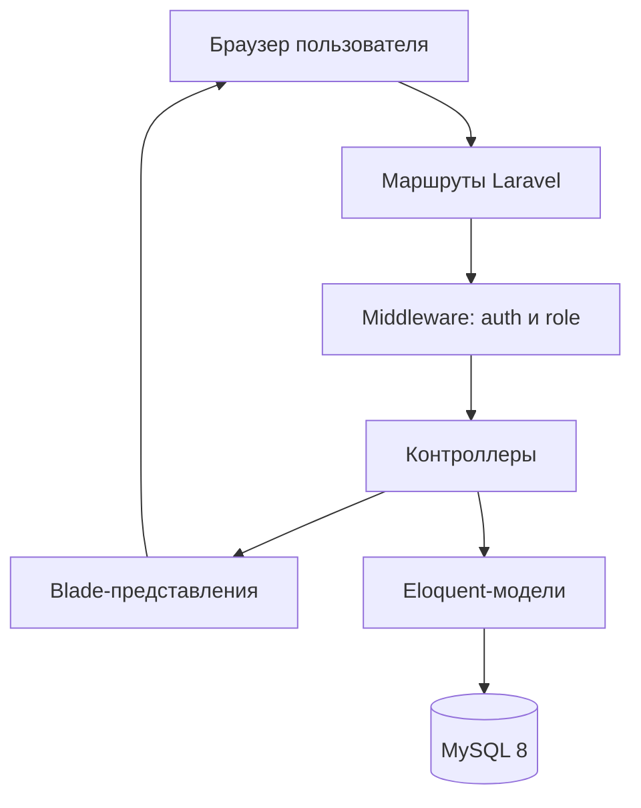
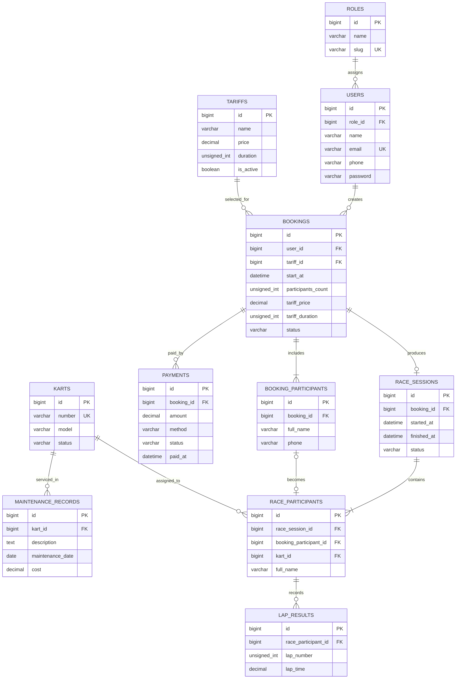
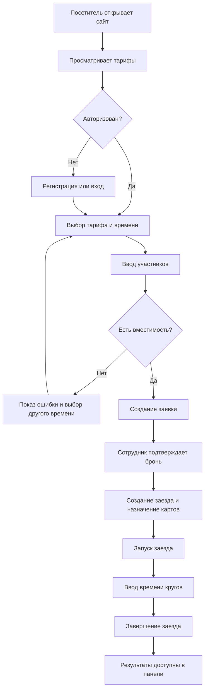

# Проектирование информационной системы APEX Karting

## 1. Назначение и границы системы

APEX Karting автоматизирует основные операции одного картодрома: публикацию тарифов, регистрацию клиентов, приём и обработку бронирований, учёт участников, распределение картов, регистрацию платежей, проведение заездов, ввод результатов кругов и учёт технического обслуживания парка.

Система рассчитана на три авторизованные роли:

- **Клиент** — просматривает тарифы, оформляет бронирование и проверяет его состояние и оплату.
- **Сотрудник** — подтверждает или отменяет бронирования, создаёт заезды, управляет состоянием картов, запускает/завершает заезды и вводит времена кругов.
- **Администратор** — управляет клиентами, сотрудниками, тарифами, бронированиями, парком картов, обслуживанием и платежами; просматривает статистику и результаты.

Неавторизованный посетитель может просматривать публичные страницы и тарифы, но не может создавать бронирования.

## 2. Функциональные требования

| ID | Требование | Роль | Реализация |
|---|---|---|---|
| FR-01 | Просмотр главной страницы и активных тарифов | Посетитель | Публичные маршруты `/` и `/tariffs` |
| FR-02 | Регистрация и вход в систему | Посетитель | `AuthController`, таблица `users` |
| FR-03 | Просмотр собственных бронирований | Клиент | Личный кабинет `/account` |
| FR-04 | Создание бронирования с участниками | Клиент | Форма и `SiteController::storeBooking` |
| FR-05 | Проверка вместимости на временной интервал | Система | Пересечение интервалов бронирований и число действующих картов |
| FR-06 | Подтверждение или отмена заявки | Сотрудник, администратор | `StaffController`, `AdminController` |
| FR-07 | Создание заезда и назначение картов | Сотрудник | Транзакционное создание `race_sessions` и `race_participants` |
| FR-08 | Запуск, завершение и отмена заезда | Сотрудник | Изменение статуса `race_sessions` |
| FR-09 | Ручной ввод времени кругов | Сотрудник | `lap_results`, проверка принадлежности участника заезду |
| FR-10 | Управление данными клиентов | Администратор | Изменение имени, e-mail и телефона |
| FR-11 | Управление сотрудниками | Администратор | Создание учётной записи и изменение контактов/пароля |
| FR-12 | Управление тарифами | Администратор | Создание и включение/отключение тарифов |
| FR-13 | Управление парком картов | Сотрудник, администратор | Создание картов и изменение статусов/характеристик |
| FR-14 | Учёт технического обслуживания | Администратор | `maintenance_records`; карт переводится в обслуживание |
| FR-15 | Регистрация и изменение статуса платежей | Администратор | `payments`, проверка остатка суммы бронирования |
| FR-16 | Просмотр результатов заездов | Администратор, сотрудник | Список сессий, участников и времён кругов |

## 3. Нефункциональные требования

- **Безопасность:** пароли хранятся в хешированном виде; формы защищены CSRF; доступ к административным действиям проверяется серверным middleware по роли.
- **Целостность:** внешние ключи связывают предметные сущности; создание бронирования, заезда и платежа выполняется с транзакционной логикой.
- **Согласованность расписания:** активные бронирования учитываются при проверке пересечения интервалов; одновременное число участников не должно превышать доступный парк картов.
- **Удобство:** интерфейс адаптивный, русскоязычный, содержит отдельные рабочие панели клиента, сотрудника и администратора.
- **Сопровождаемость:** бизнес-логика разделена между контроллерами, моделями, миграциями и Blade-представлениями.
- **Совместимость:** PHP 8.1+, Laravel 10.50.4 и MySQL 8.

## 4. Архитектура приложения

Используется MVC-архитектура Laravel:

- **Маршруты** определяют URL, HTTP-метод, имя маршрута и требуемую роль.
- **Middleware** проверяет наличие сессии авторизации и роль пользователя до выполнения защищённого контроллера.
- **Контроллеры** принимают запрос, валидируют данные, выполняют бизнес-операции и возвращают представление или перенаправление.
- **Модели Eloquent** описывают сущности и связи между таблицами.
- **Blade** формирует интерфейс на сервере; Bootstrap 5 используется для сетки и элементов управления.
- **MySQL** хранит постоянные данные системы.

## 5. Логическая модель данных

### Основные ограничения целостности

- `users.email`, `roles.slug` и `karts.number` уникальны.
- У одного бронирования не более одной сессии заезда (`race_sessions.booking_id` уникален).
- Один карт не может быть назначен двум участникам одной сессии (`race_participants` уникальность пары `race_session_id + kart_id`).
- Номер круга уникален для участника (`lap_results` уникальность пары `race_participant_id + lap_number`).
- Удаление связанных записей ограничено внешними ключами, чтобы не терять историю оплат и заездов.
- В `bookings` фиксируются цена и длительность тарифа на момент оформления заявки.

### Нормализация

Сущности пользователей, ролей, тарифов, бронирований, участников, платежей, картов, обслуживания, заездов и результатов вынесены в отдельные таблицы. Повторяющиеся группы участников, платежей, технических записей и кругов представлены отношениями «один ко многим», а не наборами колонок в родительской записи. Связь участника бронирования с участником заезда оформлена внешним ключом. Денежные значения хранятся в `DECIMAL`, а не в типе с плавающей точкой.

## 6. Основные сценарии использования

## 7. Сценарии проверки

1. Клиент регистрируется и входит в личный кабинет.
2. Клиент создаёт бронирование на будущее время с несколькими участниками.
3. Повторное бронирование на тот же интервал отклоняется, если суммарное число участников превышает вместимость активного парка.
4. Пользователь с ролью клиента получает отказ при обращении к `/admin`.
5. Сотрудник подтверждает заявку и создаёт заезд; каждому участнику назначается отдельный свободный карт.
6. Сотрудник запускает заезд, вводит время круга, завершает сессию; карты возвращаются в доступное состояние.
7. Администратор добавляет платёж и не может зарегистрировать сумму выше неоплаченного остатка.
8. Администратор создаёт запись обслуживания; карт автоматически получает статус «обслуживание».

## 8. Ограничения и дальнейшее развитие

В текущей версии нет подключения к платёжному шлюзу, автоматического хронометража, отправки e-mail/SMS, восстановления пароля и полноценного журнала аудита. Платёжная подсистема учитывает зарегистрированные суммы, но не проводит банковские операции. Время кругов вносится сотрудником вручную.
